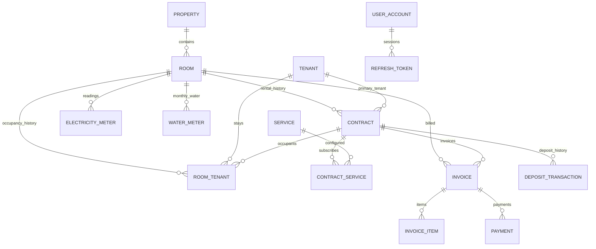

# Đặc tả MVP quản lý phòng trọ

## Mục đích và quy mô

Thay thế Excel và theo dõi thủ công bằng quy trình: phòng → người thuê → hợp đồng
→ chỉ số điện/nước → hóa đơn → thanh toán. Ưu tiên tính đúng tiền hàng tháng,
không ghi trùng và giữ lịch sử để đối chiếu.

Ban đầu có một Property với P01–P09, mỗi phòng khoảng 20 m², có gác, điều hòa
và điện riêng. Schema không giới hạn số phòng hoặc số dãy trọ.
Các giá 3.000.000đ tiền thuê/cọc, 3.500đ/kWh và 100.000đ/người trong đặc tả là
ví dụ; chưa dùng làm giá áp dụng thực tế cho cả dãy trọ.

## Phạm vi

MUST: đăng nhập, phòng, khách thuê, hợp đồng, điện, nước, dịch vụ, lập hóa đơn,
ghi nhận thanh toán, tiền cọc, lịch sử thuê, dashboard doanh thu và công nợ.

SHOULD: ảnh đồng hồ, lịch sử sửa chỉ số, PDF, Excel, QR chuyển khoản,
nhắc thanh toán. Zalo có thể bổ sung sau khi xác định cách tích hợp.

Ngoài phiên bản đầu: mobile native, tự động thu tiền online, IoT,
microservices và Kubernetes. Redis chưa bắt buộc.

## Công nghệ

Java 21, Spring Boot 3.x, Maven, Spring Security, JPA/Hibernate, PostgreSQL,
Flyway, Lombok, Swagger/OpenAPI. Triển khai bằng Docker và Docker Compose.
Xác thực đích: JWT access token, refresh token và phân quyền theo role.

## Mô hình dữ liệu đích

| Entity | Dữ liệu chính và trách nhiệm |
| --- | --- |
| Property | Tên, địa chỉ dãy trọ; có nhiều Room |
| Room | roomNumber, name, area, hasLoft, hasAirConditioner, monthlyRent, depositAmount, status, description |
| Tenant | fullName, phone, citizenId, dateOfBirth, address, gender, vehiclePlate, note |
| RoomTenant | room, tenant, contract, role, moveInDate, moveOutDate; giữ lịch sử người ở |
| Contract | room, người đứng hợp đồng, startDate, endDate, monthlyRent, depositAmount, paymentDueDay, status, note |
| ElectricityMeter | room, month, year, previousReading, currentReading, usage, pricePerKwh, amount, imageUrl |
| WaterMeter | room, month, year, calculationType, previousReading, currentReading, usage, pricePerM3, personCount, pricePerPerson, amount |
| Service | name, calculationType, price, active |
| ContractService | contract, service, đơn giá đã thỏa thuận, số lượng; dịch vụ áp dụng cho từng hợp đồng |
| Invoice | room, contract, month, year, các tổng thành phần, discount, totalAmount, status, dueDate, paidAt |
| InvoiceItem | invoice, type, description, quantity, unitPrice, amount; lưu thông tin tại thời điểm lập hóa đơn |
| Payment | invoice, amount, paymentMethod, paymentDate, referenceCode, note |
| DepositTransaction | contract, loại thu/hoàn/khấu trừ cọc, amount, transactionDate, note |
| UserAccount | username, passwordHash, role, enabled |
| RefreshToken | user, tokenHash, expiresAt, revokedAt; phục vụ refresh và logout |

Tất cả entity có id và thời điểm tạo; dữ liệu có thể sửa có updatedAt.
Tiền dùng BigDecimal/NUMERIC, ngày dùng LocalDate, thời điểm dùng Instant.
Không trả trực tiếp entity JPA từ REST API; dùng DTO và truy vấn phù hợp cho danh sách.

RoomTenant lưu một dòng cho mỗi lần ở; khi chuyển phòng, đóng dòng cũ và tạo
dòng mới. Không cập nhật phòng trên Tenant làm mất lịch sử. Contract.tenant là
người đại diện; cần kiểm tra người đó thuộc danh sách người ở của hợp đồng.

ElectricityMeter và WaterMeter trong MVP đại diện bản ghi chỉ số/tính tiền
hàng tháng. Nếu cần quản lý thiết bị công tơ hoặc thay đồng hồ sẽ tách entity
thiết bị và quy trình chốt chỉ số riêng.

## Trạng thái

- Room: VACANT (trống), OCCUPIED (đang thuê), MAINTENANCE (bảo trì).
- Contract: PENDING, ACTIVE, EXPIRED, TERMINATED.
- RoomTenant role: PRIMARY_TENANT, OCCUPANT.
- Water calculation: METER, PER_PERSON.
- Service calculation: FIXED, PER_PERSON, PER_VEHICLE, METER.
- Invoice: UNPAID, PARTIALLY_PAID, PAID, OVERDUE, CANCELLED.
- Payment method: CASH, BANK_TRANSFER, OTHER.

## Quy tắc bắt buộc

| Mã | Quy tắc | Cách bảo đảm khi triển khai |
| --- | --- | --- |
| BR-01 | Mỗi phòng chỉ một hợp đồng ACTIVE | Unique index có điều kiện trong PostgreSQL, transaction và khóa phòng khi kích hoạt hợp đồng |
| BR-02 | Không cho thuê phòng OCCUPIED/MAINTENANCE | Service kiểm tra trạng thái trong cùng transaction kích hoạt hợp đồng |
| BR-03 | currentReading ≥ previousReading | Validation và CHECK constraint |
| BR-04 | Không trùng điện theo phòng/tháng/năm | UNIQUE(room_id, year, month); áp dụng tương tự cho nước |
| BR-05 | Không trùng hóa đơn theo phòng/tháng/năm | UNIQUE(room_id, year, month), kể cả thao tác tạo hàng loạt đồng thời |
| BR-06 | Tổng = phòng + điện + nước + dịch vụ + khác − giảm giá | Tính ở backend, đối chiếu InvoiceItem; không lấy tổng do client cung cấp |
| BR-07 | Thanh toán đủ → PAID | Khóa hóa đơn, tính tổng Payment, cập nhật paidAt trong transaction |
| BR-08 | Quá hạn và chưa đủ → OVERDUE | Cập nhật định kỳ và kiểm tra khi đọc/ghi; hóa đơn PAID/CANCELLED không chuyển thành OVERDUE |
| BR-09 | Kết thúc hợp đồng → phòng VACANT | Cùng transaction kết thúc hợp đồng và đóng lượt ở tương ứng |
| BR-10 | Không xóa cứng hóa đơn/thanh toán phát sinh | Không cung cấp DELETE; sửa sai bằng hủy/điều chỉnh có lịch sử |

Chỉ số: usage = currentReading − previousReading. Điện: amount = usage × pricePerKwh.
Nước METER: amount = usage × pricePerM3. Nước PER_PERSON: amount = personCount × pricePerPerson.
METER dùng số lượng đo thực tế; PER_VEHICLE dùng số xe đã đăng ký, không tự suy ra từ số người.

Đơn giá điện, nước, dịch vụ và số người/xe phải được lưu theo kỳ/hóa đơn;
đổi bảng giá sau này không thay đổi hóa đơn đã phát hành. Tiền cọc tách khỏi
doanh thu tiền thuê và thanh toán hóa đơn, có lịch sử thu/hoàn/khấu trừ.

Các CHECK cần thêm: month từ 1–12, đơn giá/số lượng không âm, payment.amount > 0,
discount không vượt tổng trước giảm giá, endDate ≥ startDate và số tiền thuê/cọc không âm.

## API đích

| Nhóm | Endpoint |
| --- | --- |
| Auth | POST /api/v1/auth/login, /refresh, /logout |
| Rooms | GET/POST /api/v1/rooms; GET/PUT/DELETE /api/v1/rooms/{id}; lọc status |
| Tenants | GET/POST /api/v1/tenants; GET/PUT /api/v1/tenants/{id} |
| Room tenants | GET/POST /api/v1/rooms/{id}/tenants; thao tác kết thúc lượt ở |
| Contracts | GET/POST /api/v1/contracts; GET/PUT /api/v1/contracts/{id}; POST /{id}/terminate, /{id}/renew |
| Electricity | POST/GET /api/v1/electricity-readings; GET /api/v1/electricity-readings/{roomId}; lọc month/year |
| Water | POST/GET /api/v1/water-readings; GET /api/v1/water-readings/{roomId}; lọc month/year |
| Services | GET/POST /api/v1/services; GET/PUT /api/v1/services/{id}; ngừng sử dụng bằng active=false |
| Contract services | GET/PUT /api/v1/contracts/{id}/services |
| Invoices | POST /api/v1/invoices/generate, /generate-monthly; GET /api/v1/invoices, /{id} |
| Payments | POST/GET /api/v1/invoices/{id}/payments |
| Deposits | POST/GET /api/v1/contracts/{id}/deposit-transactions |
| Dashboard | GET /api/v1/dashboard?month=10&year=2026; lọc propertyId nếu cần |

DELETE Room chỉ áp dụng khi chưa có dữ liệu tham chiếu; phòng có lịch sử được
ngừng sử dụng theo chính sách sẽ chốt sau. Danh sách cần phân trang, sắp xếp,
lọc và DTO; lỗi validation/trùng dữ liệu trả HTTP 400/409 với nội dung dễ hiểu.

JWT: access token thời hạn ngắn, refresh token chỉ lưu hash và luân chuyển
khi refresh. Logout thu hồi refresh token; access token đã cấp còn hiệu lực
đến khi hết hạn nếu chưa có cơ chế thu hồi. Quyền khởi đầu: OWNER và STAFF;
quyền chi tiết cần chốt trước khi triển khai authorization.

## Workflow chính

1. Chủ trọ chọn tháng/năm và dãy trọ.
2. Hiển thị phòng có hợp đồng cùng chỉ số điện/nước kỳ trước.
3. Nhập chỉ số mới hoặc số người cho nước tính theo người.
4. Backend kiểm tra kỳ, chỉ số và bản ghi trùng; tự tính mức sử dụng, thành tiền.
5. Xem trước hóa đơn: tiền phòng, điện, nước, dịch vụ, khoản khác, giảm giá.
6. Tạo hóa đơn tháng; trả kết quả từng phòng: đã tạo, đã tồn tại hoặc thiếu dữ liệu.
7. Ghi nhận từng lần thanh toán; hiển thị còn nợ, đã thanh toán và quá hạn.

Tạo hàng loạt phải có tính lặp an toàn: gọi lại không tạo trùng. Không mặc định
chỉ số thiếu bằng 0, không bỏ qua phòng lỗi mà báo thành công toàn bộ.

## Dashboard

- Tổng phòng, phòng đang thuê, phòng trống, phòng bảo trì.
- Tổng tiền hóa đơn chưa hủy của kỳ, tổng đã thanh toán cho các hóa đơn đó,
  tổng còn phải thu và danh sách phòng còn nợ.
- Doanh thu theo tiền phòng, điện, nước, dịch vụ và khoản khác.
- Nếu hiển thị dòng tiền thực thu trong tháng, tính riêng theo paymentDate;
  không đánh đồng với tổng thanh toán cho hóa đơn của tháng.
- Tiền cọc có báo cáo riêng, không cộng vào doanh thu thuê phòng.

## Những chính sách còn cần chốt

Các mục dưới đây chưa được người dùng xác nhận; chưa được tự động áp dụng vào nghiệp vụ:

- Giá thuê, tiền cọc, điện, nước và dịch vụ thực tế của từng phòng/hợp đồng.
- Chỉ số đầu tiên cần previousReading ban đầu; không giả định là 0 hoặc lấy
  kỳ gần nhất nếu thiếu kỳ trước mà không thông báo.
- Hóa đơn đầu/cuối tháng: tính trọn tháng hay theo số ngày ở thực tế.
- Đổi người thuê trong cùng tháng: quy tắc một hóa đơn/phòng/tháng cần quyết
  định người chịu tiền và cách tách khoản thu trước khi hỗ trợ nhiều hợp đồng trong kỳ.
- Ngày thu tiền không tồn tại trong tháng sẽ xử lý như thế nào; ví dụ ngày 31 tháng 2.
- Thanh toán vượt số còn nợ: từ chối hay giữ tiền trả trước.
- Sửa chỉ số hoặc dịch vụ sau khi hóa đơn đã phát hành; hủy hóa đơn đã có thanh toán.
- Cách tính số người/xe khi vào hoặc rời phòng giữa tháng.
- METER cho dịch vụ cần nguồn số đo; chỉ enum chưa đủ để tự tính.
- Role và giới hạn quyền giữa chủ trọ/nhân viên; phạm vi truy cập nhiều Property.

## Tiêu chí nghiệm thu

- [x] Seed local 1 Property, P01–P09 với diện tích/gác/điều hòa.
- [x] PostgreSQL, Flyway, JPA và Swagger khởi động; đã kiểm tra kết nối thực.
- [x] JWT login/refresh/logout và phân quyền hoạt động.
- [x] CRUD phòng/khách thuê, danh sách người ở và lịch sử chuyển phòng.
- [x] Hợp đồng, gia hạn, kết thúc, tiền cọc và lịch sử thuê.
- [x] Database ngăn hai hợp đồng ACTIVE cho một phòng; service khóa phòng khi kích hoạt.
- [x] Nhập/tính điện và nước hai cách; ràng buộc kỳ và chỉ số.
- [x] Dịch vụ từng hợp đồng, dịch vụ theo người/xe/đo lường và đơn giá theo hóa đơn.
- [x] Sinh hóa đơn và InvoiceItem đúng tổng; tạo hàng loạt không trùng.
- [x] Thanh toán nhiều lần, công nợ và quá hạn; không xóa cứng chứng từ.
- [x] Dashboard tách doanh thu, công nợ, dòng tiền và tiền cọc.
- [x] Giao diện HTML đơn giản cho đăng nhập, phòng/khách, chỉ số, hóa đơn và thanh toán.
- [x] Swagger có API nghiệp vụ.
- [x] docker compose up khởi chạy cả backend và PostgreSQL; API và Flyway đã kiểm tra trên container.
- [x] Test tích hợp hóa đơn/thanh toán, lập trùng, hợp đồng ACTIVE và JWT trên PostgreSQL.
- [x] Test cạnh tranh thực sự khi kích hoạt hợp đồng và tạo hóa đơn trên PostgreSQL.
- [x] Test đếm truy vấn danh sách phòng, khách, hợp đồng, người ở, điện, nước, hóa đơn và dashboard trên nhiều bản ghi; các API danh sách còn lại dùng projection ID, fetch join hoặc truy vấn tổng hợp.
- [x] CI chạy build/test, tạo báo cáo JaCoCo và yêu cầu ít nhất 60% line coverage.

## Đối chiếu với project hiện tại

Backend đã có entity, DTO, controller và service cho các nhóm MUST. Security
dùng JWT; refresh token lưu hash trong database. Flyway V3–V6 thêm bảng, dịch vụ Wi-Fi và
ràng buộc, giữ nguyên V1/V2. Compose chạy PostgreSQL và backend. Các tính năng
SHOULD đã có: ảnh đồng hồ, lịch sử sửa số điện, PDF, Excel, QR và danh sách
nhắc nợ. Chưa gửi Zalo/tin nhắn vì không có cấu hình tài khoản/kênh gửi.
Trang HTML đơn giản tại `/` dùng các API cho luồng chính: đăng nhập, dashboard,
phòng/khách, hợp đồng, điện nước, hóa đơn và thanh toán.
Wi-Fi là dịch vụ FIXED được seed với giá mặc định 0; từng hợp đồng chốt mức thu
riêng. Khi lập hóa đơn, khoản này xuất hiện thành InvoiceItem và nằm trong
serviceAmount. Sửa mức Wi-Fi chỉ ảnh hưởng các hóa đơn chưa phát hành.

Trước khi vận hành dữ liệu thật cần sao lưu và đối chiếu dữ liệu cũ, kiểm tra
truy vấn trên dữ liệu lớn và nâng ngưỡng coverage khi bổ sung ca kiểm thử.
Chính sách còn cần chốt ở mục phía trên vẫn giữ nguyên.

## Thứ tự triển khai đề xuất

1. Chốt chính sách tính tiền; cập nhật entity và migration có giữ dữ liệu cũ.
2. Auth JWT, DTO/validation và xử lý lỗi API thống nhất.
3. Phòng, khách thuê, lượt ở, hợp đồng và tiền cọc; test BR-01/02/09.
4. Cấu hình đơn giá/dịch vụ và nhập điện/nước; test BR-03/04.
5. Tạo hóa đơn, snapshot khoản thu và thanh toán; test BR-05–08/10.
6. Dashboard/công nợ, Docker backend, CI và kiểm tra N+1.
7. Tính năng SHOULD theo nhu cầu sau khi workflow tháng hoạt động ổn định.

Nguồn FastTrack_Req_PhonNT1 được nhắc trong yêu cầu nhưng chưa có nội dung/file
để đối chiếu. Tài liệu này chỉ dùng đặc tả được gửi trong cuộc trò chuyện,
không khẳng định đã kiểm tra template đó.
